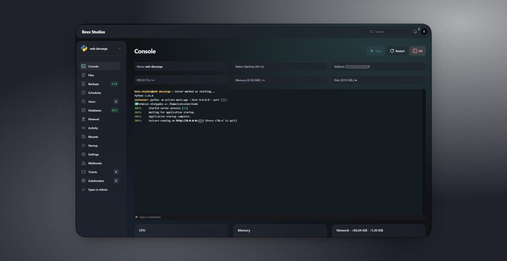
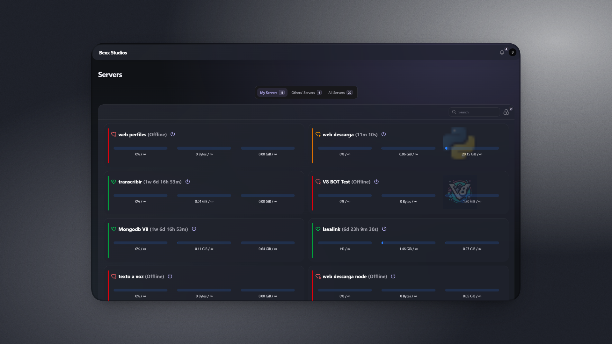

# Aurora Glass

Pelican Panel appearance plugin. Version `0.5.2`, supporting the native theme picker.

## Requirements

**v0.5.2 adds Pelican rc.4 compatibility.** It retains the glass-surface fix from v0.5.1 and all existing appearance settings; no reset or migration is required.


- Pelican Panel **v1.0.0-rc.4**, plugin API `1`, `HasTheme`, `HasPluginSettings` and `EnvironmentWriterTrait`.
- Filament 5 component structure and CSS hooks targeted by the implementation.
- Pelican's PHP and Laravel dependencies. Node.js 22+ and Yarn/Corepack are required on the panel host to build theme assets at installation.
- A current browser supporting CSS `color-mix()` and `:has()`. Blur uses `backdrop-filter`, with a solid-surface fallback.

The manifest targets **Pelican `1.0.0-rc.4` exactly**, matching the panel's strict plugin version check. On rc.3, keep **Aurora Glass v0.5.1**; on rc.2, keep **v0.4.2**. Do not bypass the manifest's compatibility check.

## Installation

1. Import `Aurora-Glass-0.5.2.zip` from Pelican's **Administration → Plugins** (not the source ZIP).
2. Complete installation, enable **Aurora Glass**, and select it in the native theme picker from your user menu/profile. An administrator can also set or force it as the default.
3. Open Aurora's plugin settings, save the appearance configuration and reload the page.
4. Select a different theme or **No theme** to verify Aurora's appearance is removed.

The manifest category remains `theme` and its ID remains `aurora-glass`. Pelican's new `HasTheme` integration applies Aurora styling only when selected, while preserving native Filament CSS. No panel-core files are patched.

## Configuration

Appearance settings are shared for all users who select Aurora Glass. Users select Light, Dark or System using Pelican's native appearance control; Aurora follows the resolved `dark` class. Theme selection is per user unless the administrator forces a theme.

The settings form provides:

- Independent **Dark palette** and **Light palette** sections, each containing nine colors.
- Shared **Glass & layout** controls.
- Aurora Violet, Ocean, Graphite and Rose presets.

Selecting a preset replaces the form values with that preset's defaults, including layout values. **Custom** leaves the current form values unchanged. Changes require saving and reloading.

See [configuration reference](docs/CONFIGURATION.md).

## Runtime

Pelican rc.4 keeps the official four-method `HasTheme` contract and active-only theme hooks. This release updates compatibility metadata without changing the established glass stylesheet. Pelican remains responsible for the native Filament CSS and the user/admin theme picker.


- Loaded in the `app`, `admin` and `server` panels.
- Implements `HasTheme` so Pelican conditionally loads Aurora's Vite entry, palette and validated CSS variables only while selected. Filament's foundational CSS remains native.
- Stores validated settings with Pelican's `EnvironmentWriterTrait` in `.env`, via `config/aurora-glass.php`.
- Adds no routes, commands, JavaScript or external requests. Vite compiles the included CSS during theme installation.
- Does not change server power actions, permissions or console transport.

## Updating and removal

For older v0.4.0 installations, export any customized database settings before upgrading (see [upgrade guide](docs/UPGRADING.md)). On rc.3, update through Pelican's plugin management screen with `Aurora-Glass-0.5.2.zip`; verify the saved appearance afterward.

Switching away or disabling the plugin stops Aurora's styling while retaining `AURORA_GLASS_*` settings in `.env`. Uninstalling does not remove those keys. An old v0.4.0 settings table, if present, is not accessed or removed.

## Source layout

```text
plugin.json
src/AuroraGlassPlugin.php
config/aurora-glass.php
resources/css/theme.css
docs/CONFIGURATION.md
docs/DEVELOPMENT.md
docs/screenshots/
```

CSS lives in `resources/css/theme.css` and is compiled with Pelican's unchanged Vite pipeline, while dynamic CSS variables come from validated `.env` configuration. Styles are gated by the active theme, not injected as global overrides. See [development and packaging](docs/DEVELOPMENT.md).

## Screenshots




[File manager](docs/screenshots/files.png) · [Plugin administration](docs/screenshots/plugins.png)

Screenshots show the installed dark appearance. Names, icons and third-party plugin entries are installation-specific.

## Release downloads

The [v0.5.1 Release](https://github.com/BernyCampos/Aurora-Glass/releases/tag/v0.5.2) provides the installable ZIP, source ZIP, `SHA256SUMS.txt` and an `update.json` for the exact rc.3 target. GitHub Actions checks both PHP 8.4/8.5 syntax and theme isolation before publication. Real rc.3 staging checks of theme switching, administration, app, server, installing, upgrading and uninstalling are still recommended.
