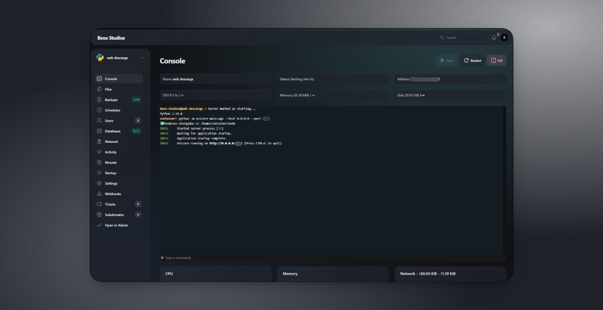
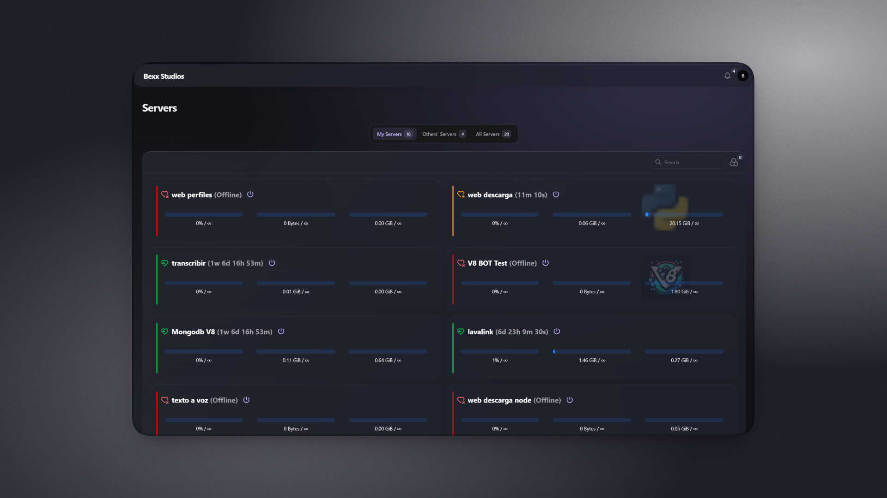

# Aurora Glass

Pelican Panel appearance plugin. Version `0.4.0`.

## Requirements

- Pelican plugin API `1`, with `HasPluginSettings` and automatic plugin migrations.
- Filament 5 component structure and CSS hooks targeted by the implementation.
- Pelican's PHP, Laravel and database dependencies; no additional Composer or npm packages.
- A current browser supporting CSS `color-mix()` and `:has()`. Blur uses `backdrop-filter`, with a solid-surface fallback.

The exact Pelican release is not pinned in `plugin.json`. Verify compatibility when updating Pelican or Filament.

## Installation

1. Import `Aurora-Glass-0.4.0.zip` from the panel's plugin administration.
2. Complete installation and enable **Aurora Glass**.
3. Open the plugin's settings, save the appearance configuration and reload the page.

For manual deployment, place the runtime files in `plugins/aurora-glass/` and complete installation through Pelican. The directory name must match the manifest ID.

The manifest category is `plugin`. Aurora Glass overlays the existing panel styles rather than replacing its compiled theme.

## Configuration

Settings are global to the panel. Users select Light, Dark or System using Pelican's native appearance control. The plugin follows the resolved `dark` class on the document root.

The settings form provides:

- Independent **Dark palette** and **Light palette** sections, each containing nine colors.
- Shared **Glass & layout** controls.
- Aurora Violet, Ocean, Graphite and Rose presets.

Selecting a preset replaces the form values with that preset's defaults, including layout values. **Custom** leaves the current form values unchanged. Changes require saving and reloading.

See [configuration reference](docs/CONFIGURATION.md).

## Runtime

- Loaded in the `app`, `admin` and `server` panels.
- Registers inline CSS through `panels::head.end`.
- Stores validated settings in `aurora_glass_settings`, row `id = 1`.
- Adds no routes, commands, JavaScript, external requests or asset dependencies.
- Does not change server power actions, permissions or console transport.

## Updating and removal

Import the new runtime ZIP and complete Pelican's update/installation flow so pending migrations run. Existing settings are merged with new defaults on read.

Disabling the plugin stops CSS injection and retains settings. Rolling back its migration drops `aurora_glass_settings` and deletes the saved appearance values. Back up that table before uninstalling if those values must be retained.

## Source layout

```text
plugin.json
src/AuroraGlassPlugin.php
database/migrations/2026_10_29_000001_create_aurora_glass_settings_table.php
docs/CONFIGURATION.md
docs/DEVELOPMENT.md
docs/screenshots/
```

CSS is embedded in `AuroraGlassPlugin.php`; no asset compilation is required. See [development and packaging](docs/DEVELOPMENT.md).

## Screenshots




[File manager](docs/screenshots/files.png) · [Plugin administration](docs/screenshots/plugins.png)

Screenshots show the installed dark appearance. Names, icons and third-party plugin entries are installation-specific.
